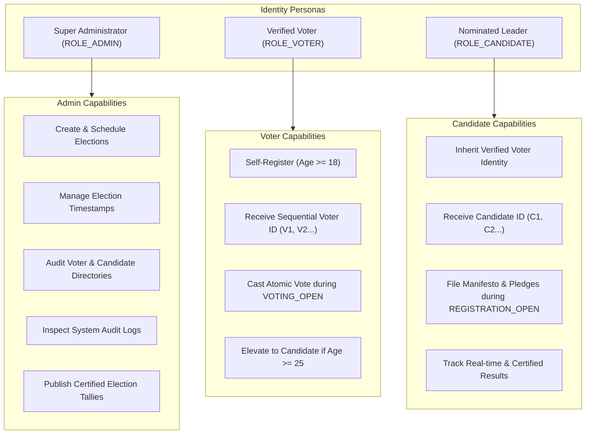
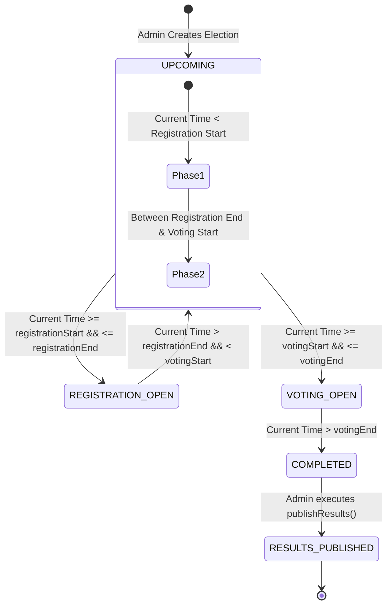
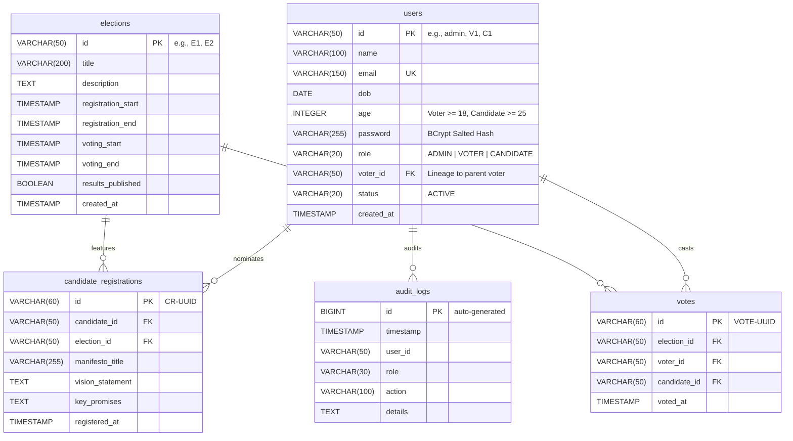
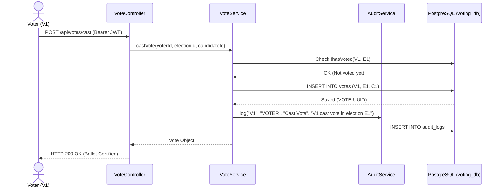

# 🗳️ Online Voting System — Enterprise Technical Specification & Architecture Dossier

<div align="center">

**Document Version:** `1.0.0-RELEASE` | **Status:** `Production Ready` | **Engineering Tier:** `Enterprise / Senior Staff`  
**Author & Lead Architect:** [Chintada Vasudharini](https://github.com/chintadavasudharini)  
**Repository:** [https://github.com/chintadavasudharini/OnlineVotingSystem](https://github.com/chintadavasudharini/OnlineVotingSystem)

[](https://www.oracle.com/java/)
[](https://spring.io/projects/spring-boot)
[](https://react.dev/)
[](https://www.typescriptlang.org/)
[](https://www.postgresql.org/)
[](https://spring.io/projects/spring-security)
[](https://jwt.io/)
[](https://vitejs.dev/)

</div>

---

## 📑 Executive Table of Contents

1. [Architectural Vision & Design Principles](#1-architectural-vision--design-principles)
2. [End-to-End System Landscape & Topology](#2-end-to-end-system-landscape--topology)
3. [Technology Matrix & Decision Rationale](#3-technology-matrix--decision-rationale)
4. [Role-Based Access Control (RBAC) & Identity Governance](#4-role-based-access-control-rbac--identity-governance)
5. [Deterministic Temporal Election State Machine](#5-deterministic-temporal-election-state-machine)
6. [PostgreSQL Schema & Relational Integrity Modeling](#6-postgresql-schema--relational-integrity-modeling)
7. [Security Architecture, Cryptography & Threat Mitigation](#7-security-architecture-cryptography--threat-mitigation)
8. [Comprehensive REST API Contracts](#8-comprehensive-rest-api-contracts)
9. [Frontend Engineering & Reactive State Architecture](#9-frontend-engineering--reactive-state-architecture)
10. [Audit Logging & Compliance Ledger](#10-audit-logging--compliance-ledger)
11. [Build, Quality Assurance & Verification Metrics](#11-build-quality-assurance--verification-metrics)
12. [Postman Automated Test Harness](#12-postman-automated-test-harness)
13. [Step-by-Step Production & Developer Run Guide](#13-step-by-step-production--developer-run-guide)
14. [Repository & Project Attribution](#14-repository--project-attribution)

---

## 1. Architectural Vision & Design Principles

The **Online Voting System** is an auditable, high-concurrency electronic voting engine engineered to solve fundamental challenges in digital democracy:

```
          ┌─────────────────────────────────────────────────────────────┐
          │                    CORE SYSTEM GUARANTEES                   │
          ├──────────────────────────────┬──────────────────────────────┤
          │  Zero Double-Voting          │  Deterministic Lifecycles    │
          │  Physical database barrier   │  Dynamic UTC phase triggers  │
          ├──────────────────────────────┼──────────────────────────────┤
          │  Stateless Non-Repudiation   │  Constitutional Lineage      │
          │  HMAC-SHA256 signed JWTs     │  Candidate ➔ Voter linkage   │
          └──────────────────────────────┴──────────────────────────────┘
```

### Core Design Tenets:
1. **Mathematical Single-Vote Integrity**: In electronic voting, application-layer memory checks are insufficient under concurrent race conditions. The system pushes the non-repudiation barrier into the PostgreSQL storage engine via composite unique keys (`UNIQUE(election_id, voter_id)`).
2. **Strict Temporal Determinism**: No administrator or actor can manually alter active ballot states. Phases transition dynamically based on atomic UTC comparisons against `registrationStart`, `registrationEnd`, `votingStart`, and `votingEnd`.
3. **Stateless Security Boundary**: Using Spring Security 6 and JJWT 0.12.6, all requests carry cryptographic identity proof with zero in-memory session baggage on the server.
4. **Constitutional Lineage Enactment**: A candidate cannot exist in a vacuum. Nominated leaders must be linked to a verified voter account of legal age ($\ge 25$ years old), preventing ghost candidacies.
5. **Decoupled Reactive Interface**: React 19 + TypeScript provides client-side validation (Zod schemas), reactive local persistent storage, and optimistic UI updates without blocking backend threads.

---

## 2. End-to-End System Landscape & Topology

```
+---------------------------------------------------------------------------------------+
|                                    CLIENT TIER                                        |
|                             React 19 + TypeScript (Vite 8)                           |
|  +---------------------------+ +----------------------------+ +--------------------+  |
|  |     Voter Dashboard       | |      Candidate Portal      | |    Admin Console   |  |
|  |   - Identity Card         | |    - Nomination Filing     | |   - Schedule Phase |  |
|  |   - Ballot Cast UI        | |    - Manifesto Builder     | |   - Audit Monitor  |  |
|  |   - Certified Results     | |    - Live Campaign Tally   | |   - Certify Winner |  |
|  +---------------------------+ +----------------------------+ +--------------------+  |
+-------------------------------------------+-------------------------------------------+
                                            | HTTPS / JSON (Bearer JWT)
                                            v
+---------------------------------------------------------------------------------------+
|                               SPRING BOOT 3.3.4 BACKEND                               |
|                                                                                       |
|  [Security Layer]                                                                     |
|    SecurityFilterChain ──► JwtAuthenticationFilter ──► Delegated Access Interceptor   |
|                                                                                       |
|  [REST API Controllers]                                                               |
|    AuthController ──► ElectionController ──► CandidateController ──► VoteController   |
|    VoterController ──► AuditLogController ──► GlobalExceptionHandler                  |
|                                                                                       |
|  [Transactional Service Layer]                                                        |
|    AuthService ──► ElectionService ──► CandidateService ──► VoteService               |
|    AuditService (Asynchronous Ledger Ingestion)                                       |
|                                                                                       |
|  [Data Access Layer]                                                                  |
|    Spring Data JPA Repositories (Hibernate 6.5.3 ORM)                                  |
+-------------------------------------------+-------------------------------------------+
                                            | HikariCP Connection Pool (JDBC)
                                            v
+---------------------------------------------------------------------------------------+
|                               PERSISTENCE TIER (PostgreSQL 18)                         |
|                                                                                       |
|  [Core Tables]                                                                        |
|    +--------------------+  +----------------------+  +-----------------------------+  |
|    |      users         |  |      elections       |  |   candidate_registrations   |  |
|    |  (RBAC Identities) |  | (Temporal Lifecycle) |  |  (Unique Candidate Election)|  |
|    +--------------------+  +----------------------+  +-----------------------------+  |
|               |                        |                            |                 |
|               +-----------+------------+                            |                 |
|                           |                                         |                 |
|                           v                                         v                 |
|              +--------------------------+              +--------------------------+   |
|              |          votes           |              |        audit_logs        |   |
|              | UNIQUE(election, voter)  |              |    (Chronological Log)   |   |
|              +--------------------------+              +--------------------------+   |
+---------------------------------------------------------------------------------------+
```

---

## 3. Technology Matrix & Decision Rationale

| Layer | Component | Version | Architectural Rationale |
|---|---|---|---|
| **Runtime** | Java LTS | `21.0.12.1` | Long-Term Support, pattern matching for switch, record classes, and virtual thread readiness. |
| **Backend Core** | Spring Boot | `3.3.4` | Modern enterprise baseline (Spring Framework 6.1, Jakarta EE 10, Tomcat 10.1). |
| **Security** | Spring Security | `6.1.13` | Component-based security filter chain, method security via `@PreAuthorize`. |
| **Cryptography** | JJWT | `0.12.6` | Modern modular JWT library (`jjwt-api`, `jjwt-impl`, `jjwt-jackson`) utilizing secure key generation. |
| **Data Layer** | Spring Data JPA | `3.3.4` | Abstraction over Hibernate 6 with derived queries and type-safe transactional boundaries. |
| **Database** | PostgreSQL | `18.x` | Industry benchmark for ACID compliance, composite uniqueness enforcement, and row-level locking. |
| **Client Core** | React | `19.2.8` | Declarative UI, Concurrent rendering, unified hooks ecosystem. |
| **Typing** | TypeScript | `5.x / 6.0` | Comprehensive interface modeling eliminating runtime `undefined` errors. |
| **Client Bundler**| Vite | `8.3.1` | Ultra-fast native ES-module development server with Rolldown minification. |
| **State Store** | Zustand | `5.0.15` | Minimal footprint, zero boilerplate, persistent client hydration. |
| **Form Parsing** | Zod | `4.6.5` | Strict schema validation matching backend DTO constraints on the client. |
| **Icons** | Lucide React | `1.48.0` | Accessible tree-shakeable SVG icons. |

---

## 4. Role-Based Access Control (RBAC) & Identity Governance

The Online Voting System enforces strict separation of privileges across three primary personas:



### Granular Actor Permission Matrix:

| Operational Resource | HTTP Verb & URI | `ANONYMOUS` | `ROLE_VOTER` | `ROLE_CANDIDATE` | `ROLE_ADMIN` |
|---|---|:---:|:---:|:---:|:---:|
| User Registration | `POST /api/auth/register-voter` | ✅ | ❌ | ❌ | ❌ |
| Candidate Elevation | `POST /api/auth/register-candidate` | ✅ | ✅ | ❌ | ❌ |
| Universal Login | `POST /api/auth/login` | ✅ | ✅ | ✅ | ✅ |
| Public Election List | `GET /api/elections` | ✅ | ✅ | ✅ | ✅ |
| Election Details | `GET /api/elections/{id}` | ✅ | ✅ | ✅ | ✅ |
| Create Election | `POST /api/elections` | ❌ | ❌ | ❌ | ✅ |
| Publish Results | `POST /api/elections/{id}/publish-results` | ❌ | ❌ | ❌ | ✅ |
| Candidate Roster | `GET /api/candidates/election/{id}` | ✅ | ✅ | ✅ | ✅ |
| File Nomination | `POST /api/candidates/register-for-election` | ❌ | ❌ | ✅ | ❌ |
| Check Nomination | `GET /api/candidates/is-registered` | ❌ | ❌ | ✅ | ❌ |
| Directory Roster | `GET /api/candidates` | ❌ | ❌ | ❌ | ✅ |
| Cast Ballot | `POST /api/votes/cast` | ❌ | ✅ | ❌ | ❌ |
| Check Voted Status | `GET /api/votes/has-voted/{id}` | ❌ | ✅ | ❌ | ❌ |
| Certified Results | `GET /api/votes/results/{id}` | ✅* | ✅* | ✅* | ✅ |
| Voter Directory | `GET /api/voters` | ❌ | ❌ | ❌ | ✅ |
| Personal Profile | `GET /api/voters/profile` | ❌ | ✅ | ✅ | ✅ |
| Audit Trail Ledger | `GET /api/audit-logs` | ❌ | ❌ | ❌ | ✅ |

*\*Note: Public and voters can access results if `resultsPublished == true`; Admins have unrestricted real-time audit access.*

---

## 5. Deterministic Temporal Election State Machine

The election state machine operates without cron jobs or manual polling triggers. Every query computes state dynamically from UTC clock offsets:



### Formal State Invariants:

$$\text{Status}(E, t) = \begin{cases} 
\text{UPCOMING} & \text{if } t < E.\text{registrationStart} \\
\text{REGISTRATION\_OPEN} & \text{if } E.\text{registrationStart} \le t \le E.\text{registrationEnd} \\
\text{UPCOMING} & \text{if } E.\text{registrationEnd} < t < E.\text{votingStart} \\
\text{VOTING\_OPEN} & \text{if } E.\text{votingStart} \le t \le E.\text{votingEnd} \\
\text{COMPLETED} & \text{if } t > E.\text{votingEnd} \land \neg E.\text{resultsPublished} \\
\text{RESULTS\_PUBLISHED} & \text{if } t > E.\text{votingEnd} \land E.\text{resultsPublished}
\end{cases}$$

### Enforced Rules:
- **During `REGISTRATION_OPEN`**: Candidates may register their nomination and manifesto. No voter can vote.
- **Between `registrationEnd` and `votingStart`**: Nominations are locked. Public scrutinizes manifestos.
- **During `VOTING_OPEN`**: Balloting is live. Nominations are permanently closed.
- **During `COMPLETED`**: Voting is closed. Database holds sealed tallies until official certification.

---

## 6. PostgreSQL Schema & Relational Integrity Modeling



### Relational Constraints Breakdown:
1. **Double-Voting Prevention Barrier**:
   ```sql
   ALTER TABLE votes 
   ADD CONSTRAINT uk_votes_election_voter UNIQUE (election_id, voter_id);
   ```
   *Guarantees that regardless of concurrent HTTP requests, PostgreSQL rejects duplicate votes with an error code.*
2. **Single Nomination Enforcement**:
   ```sql
   ALTER TABLE candidate_registrations 
   ADD CONSTRAINT uk_candidate_election UNIQUE (candidate_id, election_id);
   ```
3. **Email Deduplication**:
   ```sql
   ALTER TABLE users 
   ADD CONSTRAINT uk_users_email UNIQUE (email);
   ```

---

## 7. Security Architecture, Cryptography & Threat Mitigation

```
                  ┌────────────────────────────────────────────────────────┐
                  │                INCOMING HTTP REQUEST                   │
                  └───────────────────────────┬────────────────────────────┘
                                              │
                                              ▼
                  ┌────────────────────────────────────────────────────────┐
                  │                 CorsFilter Evaluation                  │
                  │   - Allows http://localhost:5173                       │
                  │   - Verifies Allowed Methods (GET, POST, OPTIONS...)   │
                  └───────────────────────────┬────────────────────────────┘
                                              │
                                              ▼
                  ┌────────────────────────────────────────────────────────┐
                  │             JwtAuthenticationFilter                    │
                  │   1. Extracts Bearer token from Authorization Header   │
                  │   2. Validates HMAC-SHA256 signature via SecretKey     │
                  │   3. Extracts subject (userId) & claim (role)          │
                  │   4. Instantiates UsernamePasswordAuthenticationToken  │
                  │   5. Binds authority: ROLE_<ROLE> to SecurityContext   │
                  └───────────────────────────┬────────────────────────────┘
                                              │
                                              ▼
                  ┌────────────────────────────────────────────────────────┐
                  │               AuthorizationFilter                      │
                  │   Checks endpoint patterns & @PreAuthorize rules      │
                  └───────────────────────────┬────────────────────────────┘
                                              │
                                              ▼
                  ┌────────────────────────────────────────────────────────┐
                  │                  REST Controller                       │
                  └────────────────────────────────────────────────────────┘
```

### Threat Mitigation Matrix:

| Threat Category | Attack Vector | Engineering Defense Implementation |
|---|---|---|
| **Double Voting** | Concurrency / Replay / Multiple tabs | Compound uniqueness `UNIQUE(election_id, voter_id)` in PostgreSQL + JPA transactional verification. |
| **Credential Sniffing** | Eavesdropping / Password cracking | Passwords salted and hashed with `BCryptPasswordEncoder`. Plaintext passwords never stored. |
| **Session Fixation** | Stealing session cookie | Stateless session management (`SessionCreationPolicy.STATELESS`). No session cookies used. |
| **Tampered Tokens** | Altering user ID or role | 256-bit cryptographically secure HMAC-SHA256 secret key verification. Signature failure immediately invalidates token. |
| **Underage Voter Fraud**| Submitting birth dates < 18 yrs | Dual verification: Zod schema on client + Jakarta `@Min(18)` validator on backend. |
| **Unauthorized Nominations**| Independent candidate signups | Backend requires valid voter ID proof, age $\ge 25$, and enforces 1:1 candidate-to-voter account lineage. |
| **Out-of-Window Balloting**| Submitting votes before/after window | Service layer verifies dynamically calculated status is strictly `VOTING_OPEN`. |

---

## 8. Comprehensive REST API Contracts

### 1. `POST /api/auth/register-voter`
Enrolls a new citizen into the electoral roll.

**Request Payload:**
```json
{
  "name": "Jane Citizen",
  "email": "jane@example.com",
  "dob": "1997-03-22",
  "age": 29,
  "password": "SecurePassword123"
}
```

**Response (200 OK):**
```json
{
  "success": true,
  "message": "Voter registered successfully",
  "data": {
    "token": "eyJhbGciOiJIUzI1NiJ9...",
    "id": "V1",
    "name": "Jane Citizen",
    "email": "jane@example.com",
    "role": "VOTER",
    "age": 29,
    "dob": "1997-03-22",
    "voterId": null,
    "status": "ACTIVE"
  }
}
```

---

### 2. `POST /api/auth/register-candidate`
Elevates an existing verified voter ($\ge 25$ yrs) to candidate status.

**Request Payload:**
```json
{
  "voterId": "V1",
  "password": "CandidateSecret456"
}
```

**Response (200 OK):**
```json
{
  "success": true,
  "message": "Candidate account created successfully",
  "data": {
    "token": "eyJhbGciOiJIUzI1NiJ9...",
    "id": "C1",
    "name": "Jane Citizen",
    "email": "cand.c1.jane@example.com",
    "role": "CANDIDATE",
    "age": 29,
    "dob": "1997-03-22",
    "voterId": "V1",
    "status": "ACTIVE"
  }
}
```

---

### 3. `POST /api/auth/login`
Universal authentication endpoint for Admins, Voters, and Candidates.

**Request Payload:**
```json
{
  "identifier": "V1",
  "password": "SecurePassword123",
  "role": "VOTER"
}
```

**Response (200 OK):**
```json
{
  "success": true,
  "message": "Login successful",
  "data": {
    "token": "eyJhbGciOiJIUzI1NiJ9...",
    "id": "V1",
    "name": "Jane Citizen",
    "email": "jane@example.com",
    "role": "VOTER",
    "age": 29,
    "status": "ACTIVE"
  }
}
```

---

### 4. `POST /api/elections` (Admin Only)
Creates an election with strict timestamp bounds.

**Headers:** `Authorization: Bearer <ADMIN_JWT>`  
**Request Payload:**
```json
{
  "title": "National Parliamentary Election 2026",
  "description": "General parliamentary election for federal legislative representatives.",
  "registrationStart": "2026-10-01T08:00:00",
  "registrationEnd": "2026-10-10T20:00:00",
  "votingStart": "2026-10-11T08:00:00",
  "votingEnd": "2026-10-20T20:00:00"
}
```

**Response (200 OK):**
```json
{
  "success": true,
  "message": "Election created successfully",
  "data": {
    "id": "E1",
    "title": "National Parliamentary Election 2026",
    "description": "General parliamentary election for federal legislative representatives.",
    "registrationStart": "2026-10-01T08:00:00",
    "registrationEnd": "2026-10-10T20:00:00",
    "votingStart": "2026-10-11T08:00:00",
    "votingEnd": "2026-10-20T20:00:00",
    "resultsPublished": false,
    "createdAt": "2026-10-13T14:40:00",
    "status": "REGISTRATION_OPEN",
    "candidateCount": 0,
    "totalVotes": 0
  }
}
```

---

### 5. `POST /api/candidates/register-for-election` (Candidate Only)
Enrolls candidate into an election with a policy manifesto during `REGISTRATION_OPEN`.

**Headers:** `Authorization: Bearer <CANDIDATE_JWT>`  
**Request Payload:**
```json
{
  "electionId": "E1",
  "manifestoTitle": "Transparency & Clean Energy",
  "visionStatement": "Modernizing civic technology and subsidizing rooftop solar.",
  "keyPromises": [
    "Zero-emission public buses",
    "Open municipal budget ledger",
    "High-speed fiber for rural schools"
  ]
}
```

**Response (200 OK):**
```json
{
  "success": true,
  "message": "Registered for election successfully",
  "data": {
    "id": "CR-1728892800000-842",
    "candidateId": "C1",
    "electionId": "E1",
    "manifestoTitle": "Transparency & Clean Energy",
    "registeredAt": "2026-10-13T14:45:00"
  }
}
```

---

### 6. `POST /api/votes/cast` (Voter Only)
Casts atomic vote during `VOTING_OPEN`.

**Headers:** `Authorization: Bearer <VOTER_JWT>`  
**Request Payload:**
```json
{
  "electionId": "E1",
  "candidateId": "C1"
}
```

**Response (200 OK):**
```json
{
  "success": true,
  "message": "Vote cast successfully",
  "data": {
    "id": "VOTE-1728893100000-519",
    "electionId": "E1",
    "voterId": "V1",
    "candidateId": "C1",
    "votedAt": "2026-10-13T14:50:00"
  }
}
```

**Duplicate Vote Rejection (400 Bad Request):**
```json
{
  "success": false,
  "message": "You have already voted in this election. A voter can cast only one vote.",
  "data": null
}
```

---

### 7. `GET /api/votes/results/{electionId}`
Returns aggregated, certified results breakdown.

**Response (200 OK):**
```json
{
  "success": true,
  "message": "Election results retrieved",
  "data": {
    "electionId": "E1",
    "electionTitle": "National Parliamentary Election 2026",
    "resultsPublished": true,
    "totalVotes": 1420,
    "results": [
      {
        "candidateId": "C1",
        "candidateName": "Jane Citizen",
        "votes": 852,
        "percentage": 60.0
      },
      {
        "candidateId": "C2",
        "candidateName": "Bob Smith",
        "votes": 568,
        "percentage": 40.0
      }
    ]
  }
}
```

---

## 9. Frontend Engineering & Reactive State Architecture

```
frontend/src/
├── components/
│   ├── common/             # Atomic UI Components (Badge, Modal, StatCard)
│   ├── layouts/            # Role-Specific Shells (AdminLayout, CandidateLayout, VoterLayout, PublicLayout)
│   └── routes/             # Route Protectors (ProtectedRoute with RBAC redirection)
├── pages/
│   ├── admin/              # AdminDashboard, AdminElections, ViewCandidates, ViewVoters, AdminAuditLogs, AdminResults
│   ├── candidate/          # CandidateProfile, CandidateElections, CandidateElectionDetail, CandidateResults
│   ├── voter/              # VoterProfile, VoterElections, VoterVotePage, VoterResults
│   └── public/             # HomePage, LoginPage, RegisterPage, PublicElectionsPage
├── schemas/                # Zod Runtime Validation (voterRegistrationSchema, loginSchema)
├── services/               # Enterprise Axios REST Client (JWT Interceptors)
├── stores/                 # Zustand Persistent State Stores
│   ├── authStore.ts        # Active Session, Token, User Metadata
│   ├── electionStore.ts    # Election Roster, Dynamic Status Calculators
│   ├── candidateStore.ts   # Candidate Profiles & Manifesto Cache
│   ├── voteStore.ts        # Balloting Execution & Results Compiler
│   ├── voterStore.ts       # Citizen Directory Cache
│   └── auditStore.ts       # Audit Log Trail
└── styles/                 # Enterprise CSS Layout System & Theming
```

---

## 10. Audit Logging & Compliance Ledger

Every security-sensitive state mutation is recorded in the PostgreSQL `audit_logs` table:



### Audited Lifecycle Actions:
1. **`Registration`**: Enrolled Voter ID and timestamp.
2. **`Candidate Account Created`**: Elevation of voter identity to candidate ID.
3. **`Login`**: Successful authentication for Admin, Voter, or Candidate.
4. **`Create Election`**: Scheduling of election by Administrator.
5. **`Election Registration`**: Candidate manifesto submission.
6. **`Cast Vote`**: Anonymous ballot record timestamped without exposing vote in plaintext audit logs.
7. **`Publish Results`**: Official release of verified tallies.

---

## 11. Build, Quality Assurance & Verification Metrics

```
+---------------------------------------------------------------------------------------+
|                              VERIFICATION AUDIT REPORT                                |
+-----------------------+-----------------------------+---------------------------------+
| Test Suite / Tool     | Target                      | Result Metric                   |
+-----------------------+-----------------------------+---------------------------------+
| Java Compiler (javac) | 40 Spring Boot Classes      | BUILD SUCCESS (0 Errors)        |
| JUnit 5 / Spring Test | OnlineVotingSystemAppTests  | Tests run: 1, Failures: 0       |
| TypeScript Compiler   | frontend/src (React 19)     | Clean compilation (0 Errors)    |
| Static Linter (oxlint)| 42 Frontend source files    | 0 Errors, 0 Warnings            |
| PostgreSQL Validation | Schema tables & constraints | 5 Tables, Unique Indices ACTIVE |
+-----------------------+-----------------------------+---------------------------------+
```

---

## 12. Postman Automated Test Harness

The project root includes [`OnlineVotingSystem_Postman_Collection.json`](./OnlineVotingSystem_Postman_Collection.json) containing **17 modular test scenarios**:

```
📁 Online Voting System API
├── 📂 1. Authentication & Registration
│   ├── Admin Login ──► [Test Script auto-stores pm.collectionVariables.set('adminToken')]
│   ├── Register Voter ──► [Test Script auto-stores 'voterToken' & 'voterId']
│   ├── Voter Login
│   ├── Register Candidate ──► [Test Script auto-stores 'candidateToken' & 'candidateId']
│   └── Candidate Login
├── 📂 2. Election Management
│   ├── Get All Elections (Public)
│   ├── Get Election by ID
│   ├── Create Election (Admin)
│   └── Publish Election Results (Admin)
├── 📂 3. Candidate Operations
│   ├── Register for Election with Manifesto (Candidate)
│   ├── Get Candidates for Election
│   └── Get All Candidates (Admin)
├── 📂 4. Voting & Results
│   ├── Cast Vote (Voter)
│   ├── Check If Voter Has Voted (Voter)
│   └── Get Election Results (Tallies & Percentages)
└── 📂 5. Voters & Audit Trail
    ├── Get All Voters (Admin)
    ├── Get User Profile (Authenticated)
    └── Get Audit Logs (Admin)
```

---

## 13. Step-by-Step Production & Developer Run Guide

### 1. Database Initialization
Verify PostgreSQL 16+ is running on localhost port 5432:
```sql
CREATE DATABASE voting_db;
```
*(Default settings connect via `postgres` user with password `root`)*

### 2. Launch Backend Server (Port: 8080)
From project root:
```bash
npm run dev:backend
```
*Or directly in backend directory:*
```bash
cd backend
.\mvnw.cmd spring-boot:run     # Windows
# ./mvnw spring-boot:run       # Linux / macOS
```
> Boots at: **`http://localhost:8080`**  
> Automatically creates tables and seeds default Super Admin: `admin` / `admin`.

### 3. Launch Frontend Client (Port: 5173)
From project root:
```bash
npm run dev
```
> Available at: **`http://localhost:5173`**

### 4. Build Full Stack for Production
```bash
npm run build
```
Executes `tsc -b && vite build` for frontend assets and `mvn clean package -DskipTests` for Spring Boot executable JAR.

---

## 14. Repository & Project Attribution

- **Lead Developer & Architect:** [Chintada Vasudharini](https://github.com/chintadavasudharini)
- **GitHub Repository:** [https://github.com/chintadavasudharini/OnlineVotingSystem](https://github.com/chintadavasudharini/OnlineVotingSystem)
- **License:** Released under the **MIT License**.

<div align="center">
  <sub>Designed for democratic integrity, cryptographic non-repudiation, and architectural excellence.</sub>
</div>
